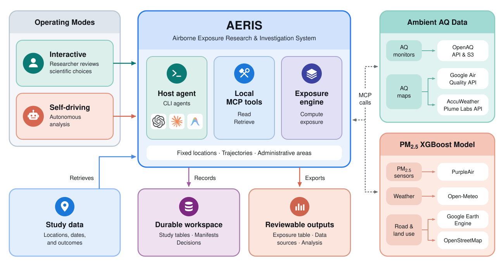
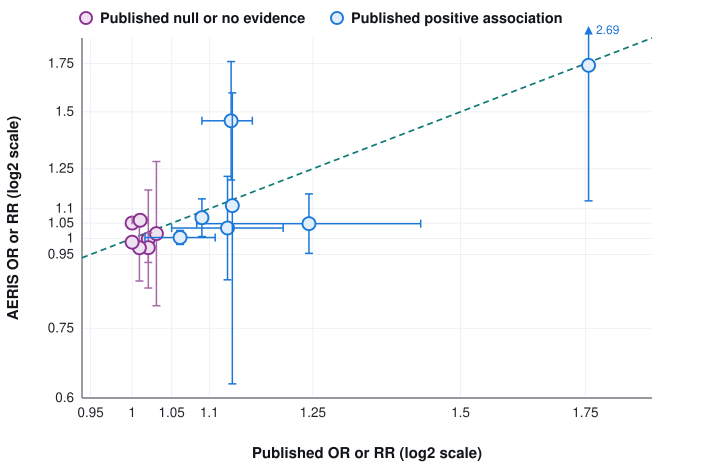
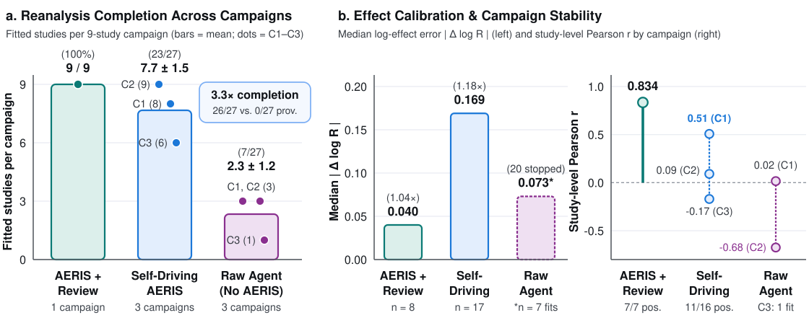

# AERIS — Airborne Exposure Research & Investigation System


[](https://huggingface.co/datasets/rlacombe/aeris)
[](https://rlacombe.github.io/aeris/)

A provider-neutral research harness and Model Context Protocol (MCP) server for air-pollution exposure assessment and environmental-health research. AERIS gives coding agents the domain tools to link cohort locations and time windows to public air-quality records, complete with coverage diagnostics, causal-design records, and an auditable decision log.

<p align="center">
  
</p>

## Overview

Accurately quantifying air-pollution exposure requires selecting appropriate monitoring or modeling sources, aligning them with study geographies and time windows, and preserving provenance for review. AERIS consolidates these tasks into an agent-ready workflow accessible from a local CLI coding agent (Codex, Claude Code, or Antigravity), any MCP-capable host, or a Python API.

AERIS supports two operating modes:
- **Interactive Mode**: The researcher reviews and approves scientific choices—such as the exposure estimand, spatial assignment method, and completeness rules—before long-running retrieval or estimation executes.
- **Self-Driving Mode**: For end-to-end automated reanalysis (`docs/autonomous-reanalysis.md`), the agent locks a machine-checkable study design contract, probes public archives, executes exposure reconstruction and statistical fitting, and records structured provenance and blocker evidence without human intervention.

## Evaluation Archive (`evals/` & Hugging Face Dataset)

The complete source-substitution reanalysis benchmark from our paper (*Towards Autonomous Environmental Health: AERIS, a Research Agent for Air-Pollution Exposure Assessment*) is available both in [`evals/`](evals/README.md) and interactively on Hugging Face at **[`huggingface.co/datasets/rlacombe/aeris`](https://huggingface.co/datasets/rlacombe/aeris)**:
- **Study-identification pipeline** (`evals/literature-search/` and `evals/docs/`): PubMed and OpenAlex retrieval scripts, screening prompts, and eligibility ledgers across 18,919 records.
- **Scientist-reviewed reanalyses** (`evals/replications/` and `evals/RESEARCHER_INTERVENTION_LEDGER.md`): Executable public-input retrieval, AERIS exposure reconstruction, and model-fitting scripts for 15 execution attempts (9 fitted reanalyses, 6 documented coverage/access blockers).
- **Autonomous & raw-agent controls** (`evals/controls/self-driving/` and `evals/controls/raw-agents/`): Three zero-intervention self-driving AERIS campaigns (27/27 protocol-accepted runs completed; 23 fitted, 4 evidenced stops) and three matched raw-agent ablation campaigns, with full run manifests and transcripts.
- **Upstream provider attribution** (`evals/OPENAQ_ATTRIBUTION_MANIFEST.md`): Station- and provider-level attribution and license audit across all fitted studies.

<p align="center">
  
</p>

<p align="center">
  
</p>

## The AERIS Agent

Most exposure assessment tools expect researchers to already know which API to
call, which parameters to tune, and which design choices require review. AERIS
supplies the domain-specific tools, session state, provenance, and instructions
that let an existing CLI agent guide that workflow without making one model
provider part of the scientific implementation.

### What the agent does

AERIS maintains a **session state** — your loaded cohort, exposure results, causal DAG, and an auditable log of every analytical decision — and uses this context to reason about your specific study. On every turn, the agent sees your cohort size, geographic coverage, temporal extent, exposure distributions, and current progress, so its suggestions are always grounded in your actual data.

The agent follows a **5-step guided workflow**, but never enforces it rigidly — you can jump ahead, circle back, or go off-script at any time:

1. **Cohort Analysis** — Load your CSV, auto-detect static or dynamic mode, summarize geographic distribution, date ranges, and data completeness. Proactively suggest which estimation approaches are possible given your data.

2. **Mechanism Exploration** — Search the scientific literature for relevant exposure-outcome evidence. Generate a **causal directed acyclic graph (DAG)** that encodes the relationships between exposure, outcome, confounders, mediators, and colliders — with step-by-step reasoning for every edge.

3. **Modeling Decisions** — Based on your data characteristics (ZIP codes vs. GPS coordinates, date range, cohort size), recommend static vs. dynamic estimation, which pollutant(s), which metric(s), and how many stations for spatial averaging. Every recommendation is logged with its rationale.

4. **Exposure Computation** — Run the estimation for your chosen pollutants. Compare exposure metrics (mean, median, p75, p95) across pollutants and metrics. Flag subjects with low data completeness or outlier values.

5. **Analysis Integration** — Read your existing R or Python analysis script, integrate the exposure variables, suggest an adjustment set derived from the DAG, execute the analysis, and flag potential issues (confounding, measurement error, ecological fallacy).

### Why this matters

**Embedded epidemiological knowledge.** AERIS is not a generic chatbot that happens to call an air quality API. Its system prompt encodes domain knowledge about common air pollutants, exposure metrics, assessment methods, health outcomes, confounders, and known biases (ecological fallacy, Berkson-type measurement error, exposure misclassification, selection bias, immortal time bias). It enforces causal inference principles: it will never adjust for a mediator (which would block the causal effect) or a collider (which would induce Berkson's bias).

**Auditable decision log.** Every analytical choice — pollutant selection, exposure model, confounder adjustment, data exclusion, sensitivity analysis — is recorded with its rationale, alternatives considered, and the data context at the time of the decision. This log can be exported as publication-ready markdown for supplementary materials, providing the transparency that reviewers and replication efforts require.

**Structured causal DAGs.** DAG generation is not freeform text — it uses structured tool calls that force the model to specify each node's role (exposure, outcome, confounder, mediator, collider, effect modifier), justify each directed edge, and produce an explicit adjustment recommendation. DAGs can be exported as Graphviz DOT, Mermaid diagrams, or ASCII art.

**Data-grounded reasoning.** The agent doesn't give generic advice. Because it injects your current data context into every turn — cohort size, geographic coverage, date ranges, exposure distributions, completeness statistics, QC flags — its recommendations are specific to your study. When it suggests using IDW averaging with 3 stations, it's because it has seen your cohort's spatial distribution relative to the monitoring network.

### Sample conversation

```
You:   I have a cohort of 200 children in the Boston area. I want to assess their
       PM2.5 and NO2 exposure over 2023 for an asthma study.

AERIS: I'll load your cohort and run multi-pollutant estimation. Let me check your
       data format first.
       → [loads cohort CSV, detects static mode, 200 participants across 45 ZIP codes]

AERIS: Running PM2.5 and NO2 estimation using OpenAQ with IDW averaging (3 nearest
       stations) and outlier detection...
       → [estimates complete: 198/200 with PM2.5 data, 195/200 with NO2]
       → Mean PM2.5: 8.2 µg/m³ (AQI: 34, Good), Mean NO2: 14.1 ppb

AERIS: I found uneven temporal coverage. I will report it for every participant
       and apply an exclusion threshold only if your protocol specifies one.
       Want me to generate a causal DAG for "PM2.5 → childhood asthma"?

You:   Yes, and then integrate the exposure data into my R mixed-effects model.

AERIS: → [generates DAG: confounders = SES, indoor smoking, temperature, humidity]
       → [reads your R script, adds exposure columns, suggests adjustment set]
       → [exports results as CSV with QC flags for your analysis]
```

### Launch AERIS without a GUI

| Method | Command | Best for |
|--------|---------|----------|
| **Codex** | `./aeris.sh --agent codex` | Codex interactive research session |
| **Claude Code** | `./aeris.sh --agent claude` | Claude Code interactive research session |
| **Antigravity** | `./aeris.sh --agent antigravity` | Antigravity interactive research session |
| **Other MCP host** | `./aeris.sh --agent custom --command "..."` | A host with its own MCP setup |

### Agent-first integration

The scientific tools, study state, provenance, and quality-control outputs are
available through a provider-neutral contract and a local MCP server. Codex,
Claude Code, and Antigravity are configured by `aeris.sh`; no AERIS model API
key or GUI is required. The host's normal authentication and approval settings
remain in effect.

```bash
pip install -e ".[mcp]"
./aeris.sh --agent codex --workspace /path/to/study
```

`aeris.sh` starts the selected host with a temporary AERIS MCP configuration.
For another host, configure `aeris-mcp` over stdio, or use the values exported
by `--agent custom`: `AERIS_MCP_COMMAND`, `AERIS_SKILL_PATH`, and
`AERIS_INITIAL_PROMPT`. The server exposes cohort loading, exposure estimation,
summaries, source observations, monitor metadata, export, structured DAG
recording, and the decision log. It deliberately does not expose arbitrary
shell execution or unrestricted file editing.

The portable host instructions are in
[`skills/aeris/SKILL.md`](skills/aeris/SKILL.md). The host must state the
exposure estimand and obtain researcher approval before `estimate_exposure` or
`estimate_boundary_exposure`.

## Quick Start

### 1. Install

```bash
git clone https://github.com/rlacombe/aeris.git
cd aeris
python -m venv .venv
source .venv/bin/activate
pip install -e ".[all]"
```

### 2. Configure API Keys

```bash
export OPENAQ_API_KEY="your_openaq_key"                        # Required for static mode
export GOOGLE_MAPS_AIR_QUALITY_API_KEY="your_google_maps_key"  # For dynamic/gmaps mode
export PURPLEAIR_API_KEY="your_purpleair_key"                  # For dynamic/xgb mode
export ACCUWEATHER_API_KEY="your_accuweather_key"              # For current/forecast AQ index inspection
```

Or create a `.env` file in the project root (requires `python-dotenv`, included in `[all]` extras).

### 3. Run

```bash
./aeris.sh --agent codex
# or: ./aeris.sh --agent claude
# or: ./aeris.sh --agent gemini
```

The installed `aeris` command offers the same launcher. Use the Python API
directly when you need a scripted workflow (see below).

## Python API & CLI

### Static Mode (Monitoring Networks)

Analyze exposure for multiple subjects using ZIP codes/addresses and date ranges, leveraging governmental monitoring networks through OpenAQ. When the v3 API has no rows for a bounded historical window, AERIS checks OpenAQ's public S3 archive by location and pollutant and records that fallback in the run provenance.

```python
from aeris.exposure import ExposureEstimatorOpenAQStatic

estimator = ExposureEstimatorOpenAQStatic(
    input_csv="cohort.csv",
    pollutant="pm25",           # pm25, pm10, no2, o3, so2, co
    country="us",               # ISO country code (default: us)
    n_stations=3,               # IDW with 3 nearest stations (default: 1)
    outlier_detection=True,     # IQR-based outlier removal
    min_completeness=None,      # Report coverage without an exclusion threshold
)
results = estimator.run(output_csv="results.csv")

# Access detailed data
hourly = estimator.get_raw_data(subject_id="S001")
daily = estimator.get_daily_data(subject_id="S001")
```

### Administrative Boundary Mode (Monitoring Networks)

For a municipality, region, county, state, or other defined area, use a polygon
rather than a centroid. AERIS supports a researcher-supplied GeoJSON file or an
open geoBoundaries administrative unit. It discovers OpenAQ monitors through the
boundary bounding box, retains only monitors inside the polygon, and reports an
unweighted mean of monitor-level means with station and time-coverage evidence.
It is not a population-weighted area concentration or personal dose.

```python
from aeris.exposure.boundaries import boundary_from_geoboundaries
from aeris.exposure import ExposureEstimatorOpenAQBoundary

boundary = boundary_from_geoboundaries("USA", 1, "California")
estimator = ExposureEstimatorOpenAQBoundary(
    boundary=boundary,
    start_date="2020-02-21",
    end_date="2020-05-19",
    pollutant="pm25",
    min_completeness=None,
)
summary = estimator.run()
stations = estimator.get_station_info()
hourly = estimator.get_raw_data()
```

geoBoundaries is an open administrative-boundary service. Its current API
metadata and geometry URL are retained in the output provenance. For a
study-specific geography, use `boundary_from_geojson("study_area.geojson")`
instead. A valid `OPENAQ_API_KEY` remains required by OpenAQ.

### Dynamic Mode (Dispersion Models)

Track exposure using GPS trajectories, integrating with dispersion models to capture temporal and spatial variability.

```python
from aeris.exposure import ExposureEstimatorGoogleMapsDynamic

estimator = ExposureEstimatorGoogleMapsDynamic(
    input_csv="gps_data.csv",
    min_completeness=None,      # Optional protocol-defined completeness cutoff
)
results = estimator.run(output_csv="results.csv")
```

### Key Flags

| Flag | Description | Default |
|------|-------------|---------|
| `--pollutant` | Pollutant code or `all` for multi-pollutant | (required, static) |
| `--n_stations` | Number of stations for IDW averaging | `1` |
| `--outlier_detection` | Enable IQR outlier removal | `false` |
| `--country` | ISO country code for geocoding | `us` |
| `--min_completeness` | Minimum completeness % for QC flagging | (none) |

## Features

- **Multi-Pollutant Estimation**: Run all 6 pollutants in a single call with `pollutant="all"`
- **IDW Spatial Averaging**: Inverse-distance-weighted averaging from multiple nearby stations
- **Outlier Detection**: IQR-based removal of sensor malfunctions and extreme values
- **Time-Weighted Means**: Exposure metrics that account for temporal sampling gaps
- **Completeness QC**: Flag subjects with insufficient temporal data coverage
- **AQI Conversion**: Convert concentrations to EPA Air Quality Index with category labels
- **GeoJSON Export**: Spatial export with lat/lon for GIS visualization
- **Causal DAG Generation**: AI-assisted directed acyclic graphs for confounding analysis
- **Flexible Data Sources**: OpenAQ monitoring networks, Google Maps Air Quality, AccuWeather air-quality indices, XGBoost dispersion
- **Static + Dynamic Modes**: Fixed-location cohorts or GPS-tracked individual trajectories
- **Automated Pipeline**: Geocoding, API auth, rate limiting, and data harmonization
- **Publication-Ready Plots**: Heatmaps, distance plots, route visualizations

## Input Data Formats

### Static Mode

```csv
subject_id,zip,address,start_date,end_date
S001,10001,,2024-01-01,2024-12-31
S002,,123 Main St NYC,2024-01-01,2024-12-31
```

Or with coordinates (skips geocoding):
```csv
subject_id,latitude,longitude,start_date,end_date
S001,40.7128,-74.0060,2024-01-01,2024-12-31
```

- **Required**: `subject_id`, `start_date`, `end_date`
- **Location**: `zip` or `address` or (`latitude` + `longitude`)
- **Dates**: ISO 8601 format (UTC recommended)

### Dynamic Mode

```csv
subject_id,timestamp,latitude,longitude
S001,2024-01-01T00:00:00Z,40.7128,-74.0060
S001,2024-01-01T01:00:00Z,40.7130,-74.0058
```

- **Required**: `subject_id`, `timestamp`, `latitude`, `longitude`
- **Coordinates**: WGS84 decimal degrees

## Supported Pollutants

- **PM2.5** (pm25): Fine particulate matter
- **PM10** (pm10): Coarse particulate matter
- **SO2** (so2): Sulfur dioxide
- **NO2** (no2): Nitrogen dioxide
- **CO** (co): Carbon monoxide
- **O3** (o3): Ozone

## Troubleshooting

**Missing API key**: Set `OPENAQ_API_KEY` (static) or `GOOGLE_MAPS_AIR_QUALITY_API_KEY` (dynamic/gmaps) in your environment or `.env` file.

**No stations found**: Try a wider date range or verify ZIP codes/addresses. Some pollutants have limited geographic coverage.

**XGBoost on macOS**: Install OpenMP runtime with `brew install libomp`.

**Google Earth Engine (XGB mode)**: Run `earthengine authenticate` and `earthengine set_project YOUR_PROJECT_ID`.

For more help, check the [examples](examples/) directory or open an [issue](https://github.com/rlacombe/aeris/issues).

## Citation

If you use AERIS in your research, please cite:

```bibtex
@inproceedings{lacombe2026aeris,
  title     = {Towards Autonomous Environmental Health: AERIS, a Research Agent for Air-Pollution Exposure Assessment},
  author    = {Lacombe, Romain and Lautman, Ziv and Efrat, Nadav and Lu, Yougeng and Snyder, Michael P.},
  booktitle = {NeurIPS 2026 Workshop on GenAI for Health (GenAI4Health)},
  year      = {2026},
  url       = {https://github.com/rlacombe/aeris}
}
```

## Acknowledgments

We thank [OpenAQ](https://openaq.org) (ROR: [`https://ror.org/03a79pm79`](https://ror.org/03a79pm79)) for maintaining open programmatic access to global air-quality observations and open-source software tools, as well as the national, regional, and municipal environmental monitoring agencies and sensor networks worldwide whose measurements make exposure reconstruction possible—including [U.S. EPA AirNow](https://www.airnow.gov/), the [European Environment Agency (EEA)](https://www.eea.europa.eu/), [Arpae Emilia-Romagna](https://www.arpae.it/), [ARPA Lazio](https://www.arpalazio.it/), [CETESB](https://cetesb.sp.gov.br/), [IEMA](https://energiaeambiente.org.br/), and [PurpleAir](https://www2.purpleair.com/). We also thank [Google Air Quality API](https://developers.google.com/maps/documentation/air-quality), [Google Earth Engine](https://earthengine.google.com/), [AccuWeather](https://www.accuweather.com/) and [Plume Labs](https://plumelabs.com/), [Open-Meteo](https://open-meteo.com/), [OpenStreetMap](https://www.openstreetmap.org/), and [geoBoundaries](https://www.geoboundaries.org/) for environmental, meteorological, and geospatial data services.

## License

This project is licensed under the MIT License - see the [LICENSE](LICENSE) file for details.
