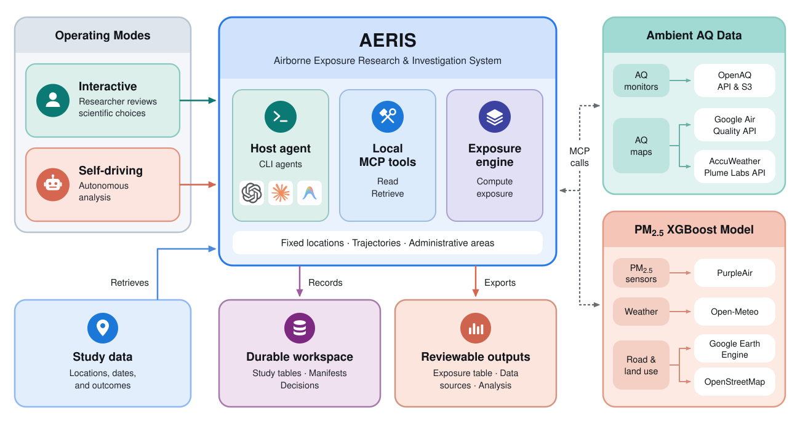
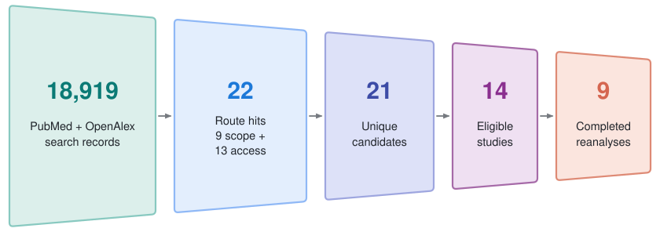
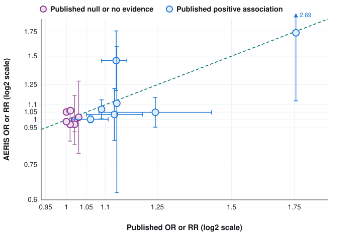
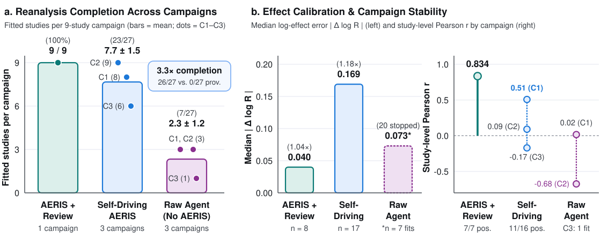

---
hide:
  - navigation
  - toc
---

<div class="aeris-hero-page" markdown="1">

# AERIS: Airborne Exposure Research & Investigation System

<div class="aeris-hero" markdown="1">
<span class="aeris-venue-badge">NeurIPS 2026 Workshop on GenAI for Health (GenAI4Health)</span>

<div class="aeris-hero-title">
Towards Autonomous Environmental Health: AERIS, a Research Agent for Air-Pollution Exposure Assessment
</div>

<div class="aeris-hero-subtitle">
A provider-neutral research-agent harness, Model Context Protocol (MCP) tool server, and exposure computation engine that links study locations and dates to public air-quality records.
</div>

<div class="aeris-authors">
Romain Lacombe<sup>1</sup> &nbsp;&middot;&nbsp; Ziv Lautman<sup>1</sup> &nbsp;&middot;&nbsp; Nadav Efrat<sup>2</sup> &nbsp;&middot;&nbsp; Yougeng Lu<sup>1</sup> &nbsp;&middot;&nbsp; Michael P. Snyder<sup>1</sup>
</div>

<div class="aeris-affiliations">
<sup>1</sup>Stanford University &nbsp;&nbsp;&middot;&nbsp;&nbsp; <sup>2</sup>University of Illinois Urbana-Champaign
</div>

<div class="aeris-actions">
  <a class="aeris-btn aeris-btn-primary" href="https://github.com/rlacombe/aeris">GitHub Repository</a>
  <a class="aeris-btn" href="https://huggingface.co/datasets/rlacombe/aeris">Hugging Face Dataset</a>
  <a class="aeris-btn" href="benchmark/">Reanalysis Benchmark</a>
  <a class="aeris-btn" href="getting-started/">1-Minute Quickstart</a>
  <a class="aeris-btn" href="agent-first/">Agent-First MCP Guide</a>
  <a class="aeris-btn" href="autonomous-reanalysis/">Autonomous Reanalysis</a>
</div>
</div>

<div class="aeris-stats-grid">
  <div class="aeris-stat-card stat-teal">
    <div class="aeris-stat-value">18,919 &rarr; 9</div>
    <div class="aeris-stat-label">Studies Screened &amp; Reanalyzed</div>
    <div class="aeris-stat-detail">Two-route PubMed &amp; OpenAlex screen down to 21 candidates, 14 eligible attempts, and 9 fitted same-pollutant reanalyses.</div>
  </div>
  <div class="aeris-stat-card stat-blue">
    <div class="aeris-stat-value">1.04&times;</div>
    <div class="aeris-stat-label">Median Effect Calibration</div>
    <div class="aeris-stat-detail">Median study-level |&Delta; log R| = 0.040 (geometric mean ratio 0.998, Pearson r = 0.834); 7/7 published positive directions retained across 14 contrasts.</div>
  </div>
  <div class="aeris-stat-card stat-plum">
    <div class="aeris-stat-value">23 / 27</div>
    <div class="aeris-stat-label">Zero-Intervention Autonomy</div>
    <div class="aeris-stat-detail">23/27 autonomous reanalyses completed across 3 campaigns (7.7 &plusmn; 1.5 fitted studies/campaign, up to 9/9) vs. 7/27 for the raw agent without AERIS.</div>
  </div>
  <div class="aeris-stat-card stat-coral">
    <div class="aeris-stat-value">1.85M</div>
    <div class="aeris-stat-label">Monitor Records Harmonized</div>
    <div class="aeris-stat-detail">1,847,519 station observations across 705 monitor-study associations aggregated into 20,568 area-time exposure estimates.</div>
  </div>
</div>

---

## Abstract

Air pollution harms human health and contributes to millions of deaths each year, yet many public-health studies omit it even when they record the locations and dates needed to estimate exposure. We introduce **AERIS (Airborne Exposure Research & Investigation System)**, a research harness that gives coding agents the domain tools to link cohort locations and time windows to public air-quality records.

To evaluate the system on a complete scientific workflow, we introduce **source-substitution reanalysis**: reconstructing a published study's pollution exposure from independent public measurements, linking it to health outcomes, and re-estimating the health effects without access to the original authors' pollution tables. Screening 18,919 papers yielded nine published studies with open health data, reproducible statistical models, and sufficient air-quality coverage. Across these studies, the pipeline processed **1,847,519 monitor observations** into **20,568 area-time exposure estimates** and **14 pollution–health comparisons** across four pollutants ($\text{PM}_{2.5}$, $\text{PM}_{10}$, $\text{NO}_2$, and $\text{O}_3$). With researcher review, reconstructed estimates matched the direction of all seven published positive associations, with a median study-level log-effect difference of **0.040** ($\approx 1.04\times$ factor; Pearson $r = 0.834$). Across three autonomous campaigns, self-driving AERIS completed **23 of 27 reanalyses** compared with **7 of 27** for the same model without the harness. For any study with location and time records, AERIS turns air-pollution exposure assessment into an auditable agent workflow, charting a path toward autonomous environmental health.

<div class="aeris-figure">
  
  <div class="aeris-figcaption">
    <strong>Figure 1 — AERIS Architecture &amp; Operating Modes.</strong> In interactive or self-driving mode, a command-line agent (Codex, Claude Code, Antigravity, or any MCP host) loads study data, queries ambient sources, and computes exposure through the AERIS skill and local MCP tool server. Both modes share a durable <code>.aeris</code> workspace that preserves inputs, causal design records, coverage diagnostics, provenance, and outputs required for scientific review.
  </div>
</div>

---

## System Overview

AERIS separates scientific reasoning from reproducible exposure computation across four components:

1. **Host Agent & AERIS Skill (`aeris.sh` / `skills/aeris/SKILL.md`)**: Launches Codex, Claude Code, Antigravity, or any compatible CLI agent in the study workspace, injects epidemiological domain instructions, and connects the local MCP server.
2. **Local MCP Tool Server (`aeris-mcp`)**: Exposes typed scientific tools over local `stdio` to inspect cohorts, lock or approve study-design records, query public repositories, assign exposure, diagnose coverage, and export provenance-backed tables.
3. **Durable Study Workspace (`.aeris/`)**: Assigns stable artifact IDs to input tables, exposure panels, and run manifests so agents can inspect schemas, missingness, and summary statistics without flooding model context with raw tables.
4. **Exposure Computation Layer (`aeris.exposure`)**: Performs postal/address/polygon resolution, monitor discovery, API + OpenAQ S3 historical archive fallback, spatial and temporal aggregation, IQR outlier flagging, and SQLite response caching.

### Two Operating Modes

<div class="aeris-card-grid" markdown="1">
<div class="aeris-card" markdown="1">
### Interactive Mode (Researcher-Reviewed)
Designed for primary epidemiological investigations. The agent inspects the cohort, proposes an exposure estimand (pollutant, spatial unit, assignment rule, time window, completeness policy), constructs a structured causal DAG, and **pauses at mandatory review gates** (`researcher_approved=true`) before executing long-running retrievals or exporting analytic endpoints.
</div>

<div class="aeris-card" markdown="1">
### Self-Driving Mode (Autonomous Reanalysis)
Designed for zero-intervention replication and sensitivity campaigns ([Autonomous Reanalysis](autonomous-reanalysis.md)). The agent locks study invariants (`lock_reanalysis_invariants`), probes public outcome and monitoring archives, logs versioned contract amendments (`amend_exposure_contract`), and passes a host-side scientific-fidelity critic before finalizing a fitted result or evidenced blocker.
</div>
</div>

### Three Exposure Computation Pathways

<div class="aeris-card-grid" markdown="1">
<div class="aeris-card" markdown="1">
### 1. Fixed-Location Monitor IDW
**Input**: Subject IDs + ZIP codes, street addresses, or coordinates + date windows.<br>
**Method**: Geocodes via `pgeocode` / Nominatim, discovers OpenAQ monitors within radius (default 25 km, up to 200 km) with automatic S3 historical archive fallback, and computes nearest-station or inverse-distance-weighted ($w_i = d_i^{-2}$) hourly and daily exposure.
</div>

<div class="aeris-card" markdown="1">
### 2. Administrative Boundary Polygon
**Input**: Named administrative unit (`iso3`, `adm_level`, `boundary_name`) or researcher GeoJSON + date window.<br>
**Method**: Resolves ADM0–ADM5 geometry via geoBoundaries, filters OpenAQ stations strictly inside the polygon, and computes monitor-first unweighted daily and period means with full station and temporal coverage diagnostics.
</div>

<div class="aeris-card" markdown="1">
### 3. Dynamic Trajectory (XGBoost / API)
**Input**: Time-stamped GPS traces (`subject_id`, `timestamp`, `latitude`, `longitude`).<br>
**Method**: Evaluates coordinate-time exposure via either the Google Maps Air Quality API (`gmaps`) or a local 600-tree **XGBoost** dispersion model (`xgb`) fusing PurpleAir/OpenAQ sensors, Open-Meteo meteorology, OpenStreetMap road proximity, and Earth Engine land cover.
</div>
</div>

---

## Empirical Highlights: Source-Substitution Reanalysis

To evaluate AERIS on complete scientific workflows rather than isolated tool calls, we screened **18,919 deduplicated PubMed and OpenAlex records** across two complementary discovery routes (scientific-scope screening and outcome-access routing), audited **21 unique candidate studies**, and executed all **14 studies** that had sufficient public inputs and methodological detail.

<div class="aeris-figure">
  
  <div class="aeris-figcaption">
    <strong>Figure 2 — Study-Selection Funnel.</strong> Two parallel routes screened 18,919 PubMed and OpenAlex records: Route 1 (scientific scope) yielded 9 studies and Route 2 (public-outcome access) yielded 13, with 1 overlap (21 unique candidates). Fourteen passed the data-and-method audit; 9 yielded fitted same-pollutant reanalyses, while 3 lacked adequate historical air-quality coverage/variation and 2 lacked a retrievable outcome export.
  </div>
</div>

<div class="aeris-figure">
  
  <div class="aeris-figcaption">
    <strong>Figure 3 — Effect-Size Calibration Across 14 Contrasts (9 Studies).</strong> Published vs. AERIS-reconstructed odds ratios (OR) and rate ratios (RR) conducted with researcher review, plotted on log<sub>2</sub> axes. Error bars denote 95% confidence intervals; the dashed teal identity line marks exact numerical agreement (study-level Pearson <em>r</em> = 0.834, median |&Delta; log R| = 0.040).
  </div>
</div>

### Primary Evaluation & Autonomous Controls (Table 1)

We compared three experimental conditions across the nine completed benchmark studies using Codex CLI (`GPT-5.6 Terra`, medium reasoning effort):

1. **AERIS with Researcher Review** (*Primary evaluation*): Scientist-supervised source-substitution reanalysis with sparse intervention at scientific branch points.
2. **Self-Driving AERIS** (*Robustness control*): Three independent nine-study campaigns (27 attempts) using frozen autonomous instructions, retry policies, and host-side critic with zero human intervention.
3. **Raw Agent Control** (*Harness ablation*): Three matched nine-study campaigns (27 attempts) with the same agent and model stripped of AERIS tools, instructions, and exposure engine.

<div class="aeris-figure">
  
  <div class="aeris-figcaption">
    <strong>Figure 4 — Autonomy &amp; Harness Ablation Comparison Across Campaigns.</strong> <strong>(a)</strong> Fitted studies completed per nine-study campaign across AERIS with researcher review (9/9), self-driving AERIS (7.7 &plusmn; 1.5; campaigns C1–C3: 8, 9, 6), and the raw-agent ablation without AERIS (2.3 &plusmn; 1.2; campaigns C1–C3: 3, 3, 1). <strong>(b)</strong> Pooled median study-level absolute log-effect error |&Delta; log R| among comparable fits (left) and study-level Pearson correlation <em>r</em> by campaign (right).
  </div>
</div>

| Measure | AERIS with Researcher Review | Self-Driving AERIS | Raw Agent Control |
| :--- | :---: | :---: | :---: |
| **Experimental Role** | Primary evaluation | Robustness control | Harness ablation |
| **AERIS Tools & Context** | Yes | Yes | No |
| **Human Researcher Intervention** | Occasional | None | None |
| **Independent Campaigns** | 1 | 3 | 3 |
| **Study Attempts** | 9 | 27 | 27 |
| **Protocol-Accepted Runs Completed** | 9 / 9 | 27 / 27 (23 fits + 4 evidenced stops) | — |
| **Fitted Studies per Campaign** | **9** (9 / 9) | **7.7 &plusmn; 1.5** (23 / 27; campaigns: 8, 9, 6) | **2.3 &plusmn; 1.2** (7 / 27; campaigns: 3, 3, 1) |
| **Complete Nine-Study Campaigns** | 1 / 1 | 1 / 3 | 0 / 3 |
| **AERIS Exposure & Provenance Record** | 9 / 9 | 26 / 27 | 0 / 27 |
| **Comparable Study-Level Estimates** | 8 | 17 | 7 |
| **Published Positive Direction Retained** | **7 / 7** | 11 / 16 | 3 / 4 |
| **Published Null / No-Evidence Retained** | **4 / 7** (all OECD) | 14 / 21 | 3 / 3 |
| **Median Study-Level \|&Delta; log R\|** | **0.040** (~1.04&times;) | 0.169 | 0.073 *(7 fits only)* |
| **Geometric Mean Reconstructed / Published** | **0.998** | 0.901 | 1.011 *(7 fits only)* |
| **Pearson *r* by Campaign** | **0.834** | 0.507 \| 0.091 \| &minus;0.170 | 0.016 \| &minus;0.675 \| — |
| **Campaign Runtime (hours)** | — | 2.10 &plusmn; 0.52 | 1.02 &plusmn; 0.01 |
| **Model Output Tokens per Campaign** | — | 275k &plusmn; 52k | 103k &plusmn; 5k |

See the [Reanalysis Benchmark](benchmark.md) page for the complete study-by-study effect table, the five execution blocker analyses, researcher intervention ledger, and links to all replication scripts and control artifacts in `evals/`.

---

## 1-Minute Quickstart

### 1. Install & Configure

```bash
git clone https://github.com/rlacombe/aeris.git
cd aeris
python -m venv .venv
source .venv/bin/activate
pip install -e ".[all]"

# Configure API keys for your chosen pathway(s)
export OPENAQ_API_KEY="your_openaq_key"                        # Static & Boundary modes
export GOOGLE_MAPS_AIR_QUALITY_API_KEY="your_google_maps_key"  # Dynamic Google Maps mode
export PURPLEAIR_API_KEY="your_purpleair_key"                  # Dynamic XGBoost mode
export ACCUWEATHER_API_KEY="your_accuweather_key"              # Optional current/forecast AQI
```

### 2. Launch with Your Preferred CLI Agent

```bash
./aeris.sh --agent codex
# or: ./aeris.sh --agent claude
# or: ./aeris.sh --agent gemini
# or: ./aeris.sh --agent antigravity
```

### 3. Or Call the Python API Directly

=== "Static Monitor IDW"

    ```python
    from aeris.exposure import ExposureEstimatorOpenAQStatic

    estimator = ExposureEstimatorOpenAQStatic(
        input_csv="cohort.csv",
        pollutant="pm25",           # pm25, pm10, no2, o3, so2, co, or all
        country="us",               # ISO country code for postal geocoding
        n_stations=3,               # Inverse-distance weighting across 3 nearest monitors
        outlier_detection=True,     # IQR-based outlier removal
        min_completeness=None,      # Report temporal completeness without hidden cutoffs
    )
    results = estimator.run(output_csv="results.csv")
    ```

=== "Administrative Boundary"

    ```python
    from aeris.exposure import ExposureEstimatorOpenAQBoundary
    from aeris.exposure.boundaries import boundary_from_geoboundaries

    boundary = boundary_from_geoboundaries("USA", 1, "California")
    estimator = ExposureEstimatorOpenAQBoundary(
        boundary=boundary,
        start_date="2020-02-21",
        end_date="2020-05-19",
        pollutant="pm25",
        min_completeness=None,
    )
    summary = estimator.run()
    stations = estimator.get_station_info()
    ```

=== "Dynamic Trajectory"

    ```python
    from aeris.exposure import ExposureEstimatorGoogleMapsDynamic

    estimator = ExposureEstimatorGoogleMapsDynamic(
        input_csv="gps_trajectories.csv",
        min_completeness=None,
    )
    results = estimator.run(output_csv="trajectory_exposure.csv")
    ```

---

## Citation

If you use AERIS or the source-substitution reanalysis benchmark in your research, please cite:

```bibtex
@inproceedings{lacombe2026aeris,
  title     = {Towards Autonomous Environmental Health: AERIS, a Research Agent for Air-Pollution Exposure Assessment},
  author    = {Lacombe, Romain and Lautman, Ziv and Efrat, Nadav and Lu, Yougeng and Snyder, Michael P.},
  booktitle = {NeurIPS 2026 Workshop on GenAI for Health (GenAI4Health)},
  year      = {2026},
  url       = {https://github.com/rlacombe/aeris}
}
```

---

## Acknowledgments & Data Attribution

We thank **[OpenAQ](https://openaq.org)** (ROR: [`https://ror.org/03a79pm79`](https://ror.org/03a79pm79)) for maintaining open programmatic access to global air-quality observations and open-source software tools. This work relies on measurements collected and published by national, regional, and municipal environmental monitoring agencies and sensor networks worldwide, including:

- **U.S. Environmental Protection Agency (EPA) AirNow** program
- **European Environment Agency (EEA)**
- **Arpae Emilia-Romagna** and **ARPA Lazio** (Italy)
- **Companhia Ambiental do Estado de São Paulo (CETESB)** (Brazil)
- **Instituto de Energia e Meio Ambiente (IEMA)** (Brazil)
- **PurpleAir** community sensor contributors

We also thank **Google** (Google Air Quality API and Google Earth Engine), **AccuWeather** and **Plume Labs**, and the **Open-Meteo**, **OpenStreetMap**, and **geoBoundaries** projects for environmental, meteorological, and geospatial data services, as well as the public-health agencies and study authors whose open outcome datasets made source-substitution reanalysis possible.

</div>
